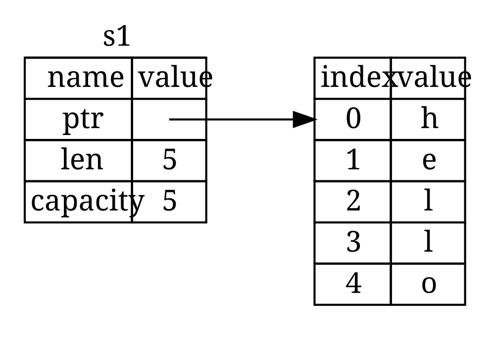
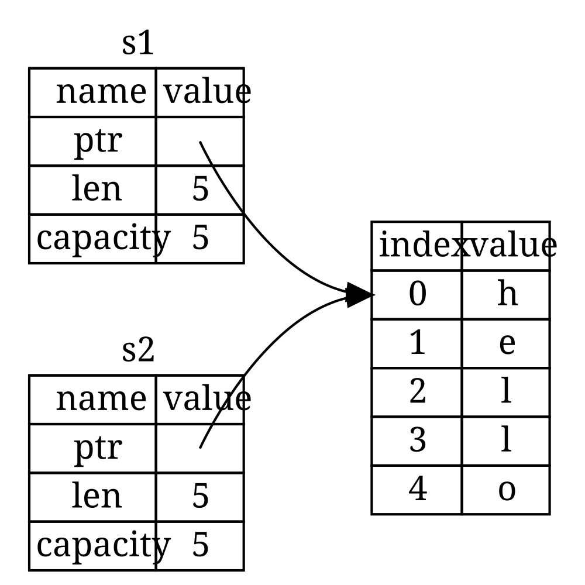
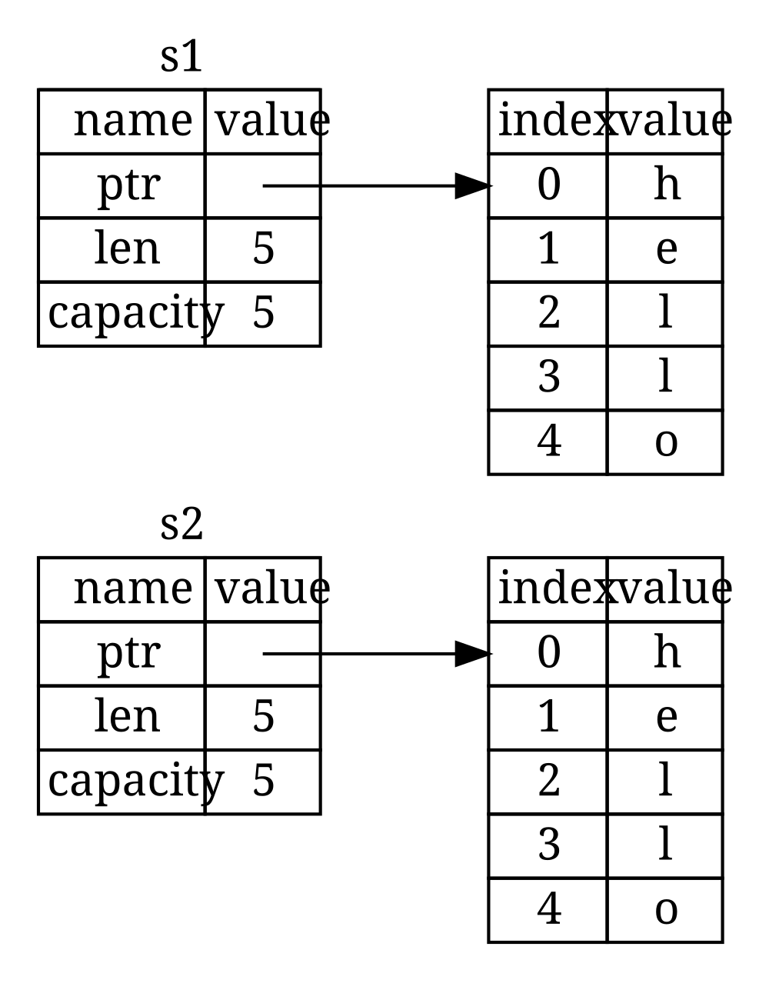
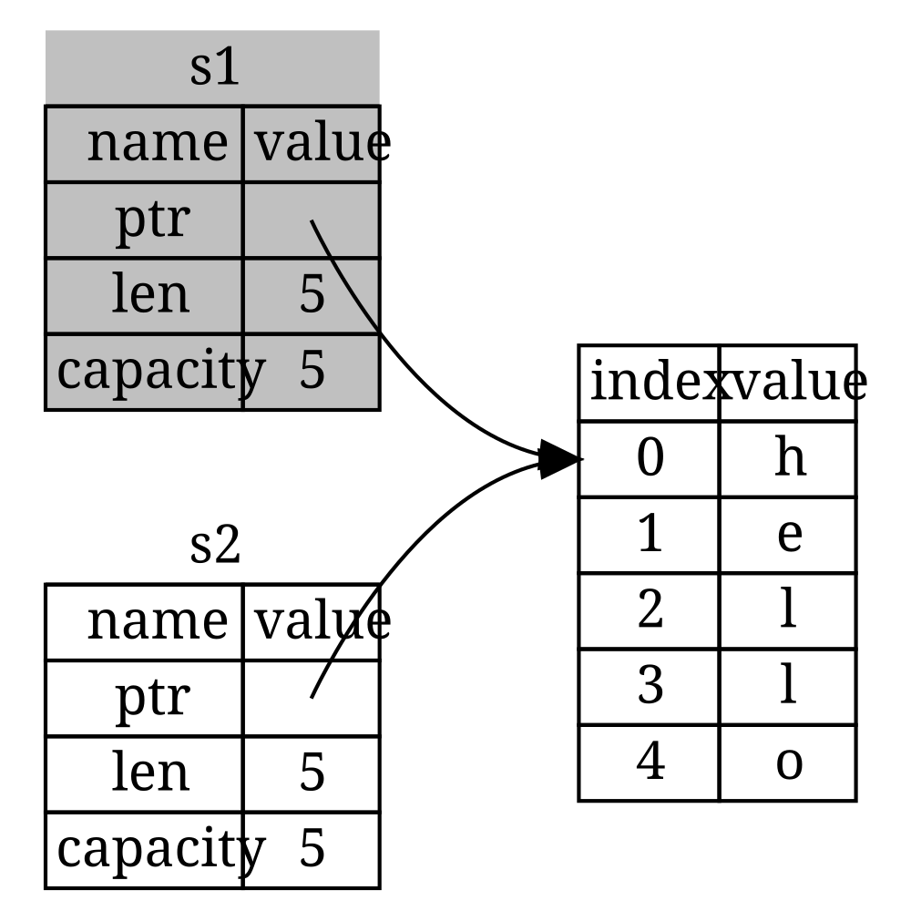
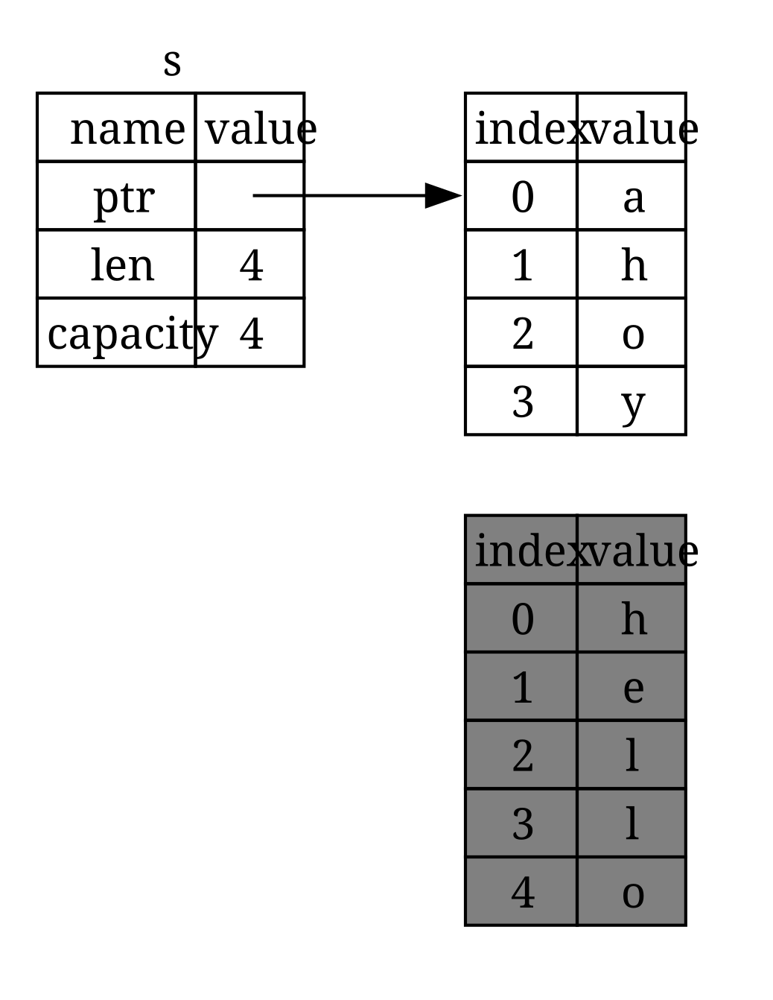

<!-- ia-translate: true -->

## O que é ownership? {#what-is-ownership}

_Ownership_ é um conjunto de regras que governa como um programa em Rust gerencia
a memória. Todos os programas precisam gerenciar a forma como usam a memória do
computador durante a execução. Algumas linguagens têm coleta de lixo (garbage
collection), que procura regularmente, enquanto o programa roda, por memória que
não está mais em uso; em outras linguagens, o programador precisa alocar e liberar
a memória explicitamente. O Rust usa uma terceira abordagem: a memória é gerenciada
por um sistema de ownership, com um conjunto de regras que o compilador verifica.
Se alguma das regras for violada, o programa não compila. Nenhum dos recursos do
ownership vai deixar seu programa mais lento durante a execução.

Como o ownership é um conceito novo para muitos programadores, leva algum tempo
para se acostumar com ele. A boa notícia é que, quanto mais experiência você tiver
com o Rust e com as regras do sistema de ownership, mais fácil será escrever, de
forma natural, código seguro e eficiente. Continue firme!

Quando você entender o ownership, terá uma base sólida para entender os recursos
que tornam o Rust único. Neste capítulo, você vai aprender ownership por meio de
alguns exemplos que se concentram em uma estrutura de dados muito comum: as
strings.

> ### A stack e a heap
>
> Muitas linguagens de programação não exigem que você pense com tanta frequência
> na stack e na heap. Mas, em uma linguagem de programação de sistemas como o Rust,
> saber se um valor está na stack ou na heap afeta o comportamento da linguagem e
> explica por que você precisa tomar certas decisões. Partes do ownership serão
> descritas em relação à stack e à heap mais adiante neste capítulo, então aqui
> vai uma breve explicação para você se preparar.
>
> Tanto a stack quanto a heap são partes da memória disponíveis para o seu código
> usar em tempo de execução, mas são estruturadas de maneiras diferentes. A stack
> armazena valores na ordem em que os recebe e os remove na ordem inversa. Isso é
> chamado de _last in, first out (LIFO)_, ou "o último a entrar é o primeiro a
> sair". Pense em uma pilha de pratos: quando você adiciona mais pratos, põe cada
> um em cima da pilha, e quando precisa de um prato, pega o de cima. Adicionar ou
> remover pratos do meio ou da base não funcionaria tão bem! Adicionar dados é
> chamado de _empilhar na stack_ (_pushing onto the stack_), e remover dados é
> chamado de _desempilhar da stack_ (_popping off the stack_). Todos os dados
> armazenados na stack precisam ter um tamanho conhecido e fixo. Dados com tamanho
> desconhecido em tempo de compilação, ou com um tamanho que pode mudar, devem ser
> armazenados na heap.
>
> A heap é menos organizada: quando você coloca dados na heap, solicita uma
> determinada quantidade de espaço. O alocador de memória encontra um espaço vazio
> na heap que seja grande o bastante, marca esse espaço como em uso e retorna um
> _ponteiro_, que é o endereço desse local. Esse processo é chamado de _alocar na
> heap_ (_allocating on the heap_) e às vezes é abreviado apenas como _alocar_
> (_allocating_) (empilhar valores na stack não é considerado alocar). Como o
> ponteiro para a heap tem um tamanho conhecido e fixo, você pode armazenar o
> ponteiro na stack, mas, quando quiser os dados em si, precisa seguir o ponteiro.
> Pense em ser acomodado em um restaurante. Quando você chega, informa quantas
> pessoas há no seu grupo, e o recepcionista encontra uma mesa vazia que caiba
> todo mundo e leva vocês até lá. Se alguém do grupo chegar atrasado, pode perguntar
> em qual mesa vocês foram acomodados para encontrá-los.
>
> Empilhar na stack é mais rápido do que alocar na heap, porque o alocador nunca
> precisa procurar um lugar para armazenar novos dados; esse local está sempre no
> topo da stack. Em comparação, alocar espaço na heap exige mais trabalho, porque o
> alocador precisa primeiro encontrar um espaço grande o bastante para guardar os
> dados e, depois, fazer o registro necessário para se preparar para a próxima
> alocação.
>
> Acessar dados na heap costuma ser mais lento do que acessar dados na stack,
> porque você precisa seguir um ponteiro para chegar até eles. Processadores
> modernos são mais rápidos quando pulam menos pela memória. Continuando com a
> analogia, pense em um garçom de restaurante que anota pedidos de várias mesas.
> É mais eficiente anotar todos os pedidos de uma mesa antes de passar para a
> próxima. Anotar um pedido da mesa A, depois um da mesa B, depois outro da A e
> depois outro da B seria um processo bem mais lento. Do mesmo jeito, um
> processador normalmente faz melhor o seu trabalho quando trabalha com dados que
> estão perto de outros dados (como acontece na stack), em vez de dados mais
> distantes (como podem estar na heap).
>
> Quando o seu código chama uma função, os valores passados para a função
> (incluindo, potencialmente, ponteiros para dados na heap) e as variáveis locais
> da função são empilhados na stack. Quando a função termina, esses valores são
> desempilhados da stack.
>
> Acompanhar quais partes do código estão usando quais dados na heap, minimizar a
> quantidade de dados duplicados na heap e limpar os dados não utilizados na heap,
> para que você não fique sem espaço, são problemas que o ownership resolve. Depois
> que você entender o ownership, não vai precisar pensar com tanta frequência na
> stack e na heap. Mas saber que o principal objetivo do ownership é gerenciar os
> dados da heap pode ajudar a explicar por que ele funciona do jeito que funciona.

### As regras do ownership {#ownership-rules}

Primeiro, vamos olhar as regras do ownership. Tenha essas regras em mente enquanto
passamos pelos exemplos que as ilustram:

- Cada valor em Rust tem um _dono_ (_owner_).
- Só pode haver um dono por vez.
- Quando o dono sai de escopo, o valor é descartado (_dropped_).

### Escopo de variáveis {#variable-scope}

Agora que já passamos da sintaxe básica do Rust, não vamos incluir todo o código
`fn main() {` nos exemplos. Então, se você estiver acompanhando, não deixe de
colocar os exemplos a seguir dentro de uma função `main` manualmente. Com isso,
nossos exemplos ficarão um pouco mais concisos, o que nos permite focar nos
detalhes reais em vez de código repetitivo.

Como primeiro exemplo de ownership, vamos olhar o escopo de algumas variáveis. Um
_escopo_ é o intervalo dentro de um programa no qual um item é válido. Considere
a seguinte variável:

```rust
let s = "hello";
```

A variável `s` se refere a um literal de string, cujo valor está fixo no texto do
nosso programa. A variável é válida desde o ponto em que é declarada até o fim do
escopo atual. A Listagem 4-1 mostra um programa com comentários que indicam onde a
variável `s` seria válida.

<Listing number="4-1" caption="Uma variável e o escopo no qual ela é válida">

```rust
{{#rustdoc_include ../listings/ch04-understanding-ownership/listing-04-01/src/main.rs:here}}
```

</Listing>

Em outras palavras, há dois momentos importantes aqui:

- Quando `s` _entra_ em escopo, ela é válida.
- Ela continua válida até _sair_ de escopo.

Neste ponto, a relação entre escopos e o momento em que as variáveis são válidas é
parecida com a de outras linguagens de programação. Agora vamos construir sobre
esse entendimento apresentando o tipo `String`.

### O tipo `String` {#the-string-type}

Para ilustrar as regras do ownership, precisamos de um tipo de dado mais complexo
do que aqueles que vimos na seção [“Tipos de dados”][data-types]<!-- ignore --> do
Capítulo 3. Os tipos vistos anteriormente têm tamanho conhecido, podem ser
armazenados na stack e desempilhados quando o escopo termina, e podem ser copiados
de forma rápida e simples para criar uma nova instância independente, caso outra
parte do código precise usar o mesmo valor em um escopo diferente. Mas queremos
examinar dados armazenados na heap e explorar como o Rust sabe quando limpar esses
dados, e o tipo `String` é um ótimo exemplo.

Vamos nos concentrar nas partes da `String` relacionadas ao ownership. Esses
aspectos também se aplicam a outros tipos de dados complexos, sejam eles fornecidos
pela biblioteca padrão, sejam criados por você. Discutiremos os aspectos da `String`
que não são de ownership no [Capítulo 8][ch8]<!-- ignore -->.

Já vimos literais de string, em que um valor de string está fixo no nosso programa.
Literais de string são práticos, mas não servem para todas as situações em que
podemos querer usar texto. Um dos motivos é que eles são imutáveis. Outro é que nem
todo valor de string pode ser conhecido quando escrevemos o código: por exemplo, e
se quisermos receber uma entrada do usuário e armazená-la? É para essas situações
que o Rust tem o tipo `String`. Esse tipo gerencia dados alocados na heap e, por
isso, consegue armazenar uma quantidade de texto que não conhecemos em tempo de
compilação. Você pode criar uma `String` a partir de um literal de string usando a
função `from`, assim:

```rust
let s = String::from("hello");
```

O operador de dois-pontos duplo `::` nos permite colocar essa função `from`
específica dentro do espaço de nomes do tipo `String`, em vez de usar algum nome
como `string_from`. Vamos discutir essa sintaxe com mais detalhes na seção
[“Métodos”][methods]<!-- ignore --> do Capítulo 5, e quando falarmos sobre espaços
de nomes com módulos em [“Caminhos para referenciar um item na árvore de
módulos”][paths-module-tree]<!-- ignore --> no Capítulo 7.

Esse tipo de string _pode_ ser modificado:

```rust
{{#rustdoc_include ../listings/ch04-understanding-ownership/no-listing-01-can-mutate-string/src/main.rs:here}}
```

Então, qual é a diferença aqui? Por que a `String` pode ser modificada, mas os
literais não? A diferença está em como esses dois tipos lidam com a memória.

### Memória e alocação {#memory-and-allocation}

No caso de um literal de string, conhecemos o conteúdo em tempo de compilação, então
o texto fica escrito diretamente no executável final. É por isso que literais de
string são rápidos e eficientes. Mas essas propriedades vêm apenas da imutabilidade
do literal. Infelizmente, não podemos colocar um bloco de memória no binário para
cada trecho de texto cujo tamanho é desconhecido em tempo de compilação e que pode
mudar enquanto o programa roda.

Com o tipo `String`, para dar suporte a um trecho de texto mutável e que pode
crescer, precisamos alocar na heap uma quantidade de memória, desconhecida em tempo
de compilação, para guardar o conteúdo. Isso significa que:

- A memória precisa ser solicitada ao alocador de memória em tempo de execução.
- Precisamos de uma forma de devolver essa memória ao alocador quando terminarmos
  com a nossa `String`.

A primeira parte é feita por nós: quando chamamos `String::from`, sua implementação
solicita a memória de que precisa. Isso é praticamente universal nas linguagens de
programação.

Porém, a segunda parte é diferente. Em linguagens com um _coletor de lixo_
(_garbage collector_, GC), o GC acompanha e limpa a memória que não está mais em
uso, e não precisamos nos preocupar com isso. Na maioria das linguagens sem GC, é
nossa responsabilidade identificar quando a memória não está mais em uso e chamar o
código que a libera explicitamente, do mesmo jeito que a solicitamos. Fazer isso
corretamente sempre foi um problema difícil de programação. Se nos esquecermos,
desperdiçamos memória. Se fizermos cedo demais, teremos uma variável inválida. Se
fizermos duas vezes, isso também é um bug. Precisamos parear exatamente um
`allocate` com exatamente um `free`.

O Rust segue outro caminho: a memória é devolvida automaticamente assim que a
variável que a possui sai de escopo. Aqui está uma versão do nosso exemplo de
escopo da Listagem 4-1, usando uma `String` em vez de um literal de string:

```rust
{{#rustdoc_include ../listings/ch04-understanding-ownership/no-listing-02-string-scope/src/main.rs:here}}
```

Existe um ponto natural em que podemos devolver ao alocador a memória de que a
nossa `String` precisa: quando `s` sai de escopo. Quando uma variável sai de escopo,
o Rust chama uma função especial por nós. Essa função se chama `drop`, e é o lugar
onde o autor da `String` pode colocar o código que devolve a memória. O Rust chama
`drop` automaticamente na chave de fechamento.

> Nota: Em C++, esse padrão de liberar recursos no fim do tempo de vida de um item
> às vezes é chamado de _Resource Acquisition Is Initialization (RAII)_. A função
> `drop` do Rust vai ser familiar para você se já usou padrões RAII.

Esse padrão tem um impacto profundo na forma como o código em Rust é escrito. Pode
parecer simples agora, mas o comportamento do código pode ser inesperado em
situações mais complicadas, quando queremos que várias variáveis usem os dados que
alocamos na heap. Vamos explorar algumas dessas situações agora.

<!-- Old headings. Do not remove or links may break. -->

<a id="ways-variables-and-data-interact-move"></a>

#### Variáveis e dados interagindo com move {#variables-and-data-interacting-with-move}

Várias variáveis podem interagir com os mesmos dados de maneiras diferentes no
Rust. A Listagem 4-2 mostra um exemplo usando um inteiro.

<Listing number="4-2" caption="Atribuindo o valor inteiro da variável `x` a `y`">

```rust
{{#rustdoc_include ../listings/ch04-understanding-ownership/listing-04-02/src/main.rs:here}}
```

</Listing>

Provavelmente conseguimos adivinhar o que isso faz: "Vincule o valor `5` a `x`;
depois, faça uma cópia do valor em `x` e vincule-a a `y`." Agora temos duas
variáveis, `x` e `y`, e ambas valem `5`. É exatamente isso que acontece, porque
inteiros são valores simples de tamanho conhecido e fixo, e esses dois valores `5`
são empilhados na stack.

Agora vamos ver a versão com `String`:

```rust
{{#rustdoc_include ../listings/ch04-understanding-ownership/no-listing-03-string-move/src/main.rs:here}}
```

Isso parece muito parecido, então podemos supor que o funcionamento seria o mesmo:
ou seja, a segunda linha faria uma cópia do valor em `s1` e a vincularia a `s2`.
Mas não é bem isso que acontece.

Dê uma olhada na Figura 4-1 para ver o que acontece com a `String` nos bastidores.
Uma `String` é formada por três partes, mostradas à esquerda: um ponteiro para a
memória que guarda o conteúdo da string, um tamanho (_length_) e uma capacidade
(_capacity_). Esse grupo de dados é armazenado na stack. À direita está a memória
na heap que guarda o conteúdo.



<span class="caption">Figura 4-1: A representação na memória de uma `String` com o
valor `"hello"` vinculado a `s1`</span>

O tamanho é a quantidade de memória, em bytes, que o conteúdo da `String` está
usando no momento. A capacidade é a quantidade total de memória, em bytes, que a
`String` recebeu do alocador. A diferença entre tamanho e capacidade importa, mas
não neste contexto, então, tudo bem ignorar a capacidade por enquanto.

Quando atribuímos `s1` a `s2`, os dados da `String` são copiados, o que significa que
copiamos o ponteiro, o tamanho e a capacidade que estão na stack. Não copiamos os
dados na heap para os quais o ponteiro aponta. Em outras palavras, a representação
dos dados na memória fica como na Figura 4-2.



<span class="caption">Figura 4-2: A representação na memória da variável `s2`, que
tem uma cópia do ponteiro, do tamanho e da capacidade de `s1`</span>

A representação _não_ se parece com a Figura 4-3, que seria como a memória ficaria se
o Rust também copiasse os dados da heap. Se o Rust fizesse isso, a operação
`s2 = s1` poderia ser muito custosa em termos de desempenho em tempo de execução se
os dados na heap fossem grandes.



<span class="caption">Figura 4-3: Outra possibilidade para o que `s2 = s1` poderia
fazer se o Rust também copiasse os dados da heap</span>

Antes, dissemos que, quando uma variável sai de escopo, o Rust chama automaticamente
a função `drop` e limpa a memória da heap daquela variável. Mas a Figura 4-2 mostra
os dois ponteiros apontando para o mesmo local. Isso é um problema: quando `s2` e
`s1` saírem de escopo, ambas tentarão liberar a mesma memória. Esse é conhecido como
um erro de _double free_ e é um dos bugs de segurança de memória que mencionamos
antes. Liberar a memória duas vezes pode levar à corrupção de memória, o que pode
levar a vulnerabilidades de segurança.

Para garantir a segurança de memória, depois da linha `let s2 = s1;`, o Rust considera
`s1` como não mais válida. Portanto, o Rust não precisa liberar nada quando `s1` sai
de escopo. Veja o que acontece quando você tenta usar `s1` depois que `s2` é criada;
não vai funcionar:

```rust,ignore,does_not_compile
{{#rustdoc_include ../listings/ch04-understanding-ownership/no-listing-04-cant-use-after-move/src/main.rs:here}}
```

Você vai receber um erro como este, porque o Rust impede que você use a referência
invalidada:

```console
{{#include ../listings/ch04-understanding-ownership/no-listing-04-cant-use-after-move/output.txt}}
```

Se você já ouviu os termos _cópia rasa_ (_shallow copy_) e _cópia profunda_ (_deep
copy_) trabalhando com outras linguagens, o conceito de copiar o ponteiro, o tamanho
e a capacidade sem copiar os dados provavelmente soa como fazer uma cópia rasa. Mas,
como o Rust também invalida a primeira variável, em vez de ser chamada de cópia rasa,
essa operação é conhecida como _move_. Neste exemplo, diríamos que `s1` foi _movida_
para `s2`. Então, o que de fato acontece está mostrado na Figura 4-4.



<span class="caption">Figura 4-4: A representação na memória depois que `s1` foi
invalidada</span>

Isso resolve o nosso problema! Com apenas `s2` válida, quando ela sair de escopo, só
ela vai liberar a memória, e pronto.

Além disso, há uma decisão de design implícita aqui: o Rust nunca vai criar
automaticamente cópias "profundas" dos seus dados. Portanto, qualquer cópia
_automática_ pode ser considerada barata em termos de desempenho em tempo de execução.

#### Escopo e atribuição {#scope-and-assignment}

O inverso também é verdadeiro para a relação entre escopo, ownership e a memória
liberada pela função `drop`. Quando você atribui um valor completamente novo a uma
variável existente, o Rust chama `drop` e libera imediatamente a memória do valor
original. Considere este código, por exemplo:

```rust
{{#rustdoc_include ../listings/ch04-understanding-ownership/no-listing-04b-replacement-drop/src/main.rs:here}}
```

Inicialmente declaramos uma variável `s` e a vinculamos a uma `String` com o valor
`"hello"`. Em seguida, criamos imediatamente uma nova `String` com o valor `"ahoy"` e
a atribuímos a `s`. Neste ponto, nada mais se refere ao valor original na heap. A
Figura 4-5 ilustra os dados da stack e da heap agora:



<span class="caption">Figura 4-5: A representação na memória depois que o valor
inicial foi substituído por completo</span>

Assim, a string original sai de escopo imediatamente. O Rust vai executar a função
`drop` nela, e sua memória será liberada na hora. Quando imprimirmos o valor no
final, ele será `"ahoy, world!"`.

<!-- Old headings. Do not remove or links may break. -->

<a id="ways-variables-and-data-interact-clone"></a>

#### Variáveis e dados interagindo com clone {#variables-and-data-interacting-with-clone}

Se _quisermos_ copiar em profundidade os dados da heap da `String`, e não apenas os
dados da stack, podemos usar um método comum chamado `clone`. Vamos discutir a sintaxe
de métodos no Capítulo 5, mas, como métodos são um recurso comum em muitas linguagens
de programação, você provavelmente já os viu antes.

Aqui está um exemplo do método `clone` em ação:

```rust
{{#rustdoc_include ../listings/ch04-understanding-ownership/no-listing-05-clone/src/main.rs:here}}
```

Isso funciona perfeitamente e produz explicitamente o comportamento mostrado na Figura
4-3, em que os dados da heap _são_ copiados.

Quando você vir uma chamada a `clone`, saiba que algum código arbitrário está sendo
executado e que esse código pode ser custoso. É um indicador visual de que algo
diferente está acontecendo.

#### Dados apenas na stack: Copy {#stack-only-data-copy}

Há mais uma particularidade que ainda não discutimos. Este código usando inteiros
— parte dele foi mostrada na Listagem 4-2 — funciona e é válido:

```rust
{{#rustdoc_include ../listings/ch04-understanding-ownership/no-listing-06-copy/src/main.rs:here}}
```

Mas esse código parece contradizer o que acabamos de aprender: não temos uma chamada
a `clone`, mas `x` continua válida e não foi movida para `y`.

A razão é que tipos como os inteiros, que têm tamanho conhecido em tempo de
compilação, são armazenados inteiramente na stack; então, fazer cópias dos valores
reais é rápido. Isso significa que não há motivo para impedir que `x` continue válida
depois que criamos a variável `y`. Em outras palavras, não há diferença entre cópia
profunda e cópia rasa aqui, então chamar `clone` não faria nada diferente da cópia
rasa usual, e podemos omiti-lo.

O Rust tem uma anotação especial chamada trait `Copy`, que podemos colocar em tipos
armazenados na stack, como os inteiros (vamos falar mais sobre traits no
[Capítulo 10][traits]<!-- ignore -->). Se um tipo implementa o trait `Copy`, as
variáveis que o usam não são movidas, mas sim copiadas de forma simples, continuando
válidas depois da atribuição a outra variável.

O Rust não nos deixa anotar um tipo com `Copy` se o tipo, ou qualquer uma de suas
partes, implementou o trait `Drop`. Se o tipo precisa que algo especial aconteça
quando o valor sai de escopo e adicionarmos a anotação `Copy` a esse tipo, teremos
um erro de compilação. Para aprender como adicionar a anotação `Copy` ao seu tipo
para implementar o trait, veja [“Traits deriváveis”][derivable-traits]<!-- ignore -->
no Apêndice C.

Então, quais tipos implementam o trait `Copy`? Você pode consultar a documentação do
tipo em questão para ter certeza, mas, como regra geral, qualquer grupo de valores
escalares simples pode implementar `Copy`, e nada que exija alocação ou que seja algum
tipo de recurso pode implementar `Copy`. Aqui estão alguns dos tipos que implementam
`Copy`:

- Todos os tipos inteiros, como `u32`.
- O tipo booleano, `bool`, com os valores `true` e `false`.
- Todos os tipos de ponto flutuante, como `f64`.
- O tipo caractere, `char`.
- Tuplas, se contiverem apenas tipos que também implementam `Copy`. Por exemplo,
  `(i32, i32)` implementa `Copy`, mas `(i32, String)` não.

### Ownership e funções {#ownership-and-functions}

A mecânica de passar um valor para uma função é semelhante à de atribuir um valor a
uma variável. Passar uma variável para uma função vai mover ou copiar a variável,
assim como a atribuição. A Listagem 4-3 tem um exemplo com algumas anotações que
mostram onde as variáveis entram e saem de escopo.

<Listing number="4-3" file-name="src/main.rs" caption="Funções com ownership e escopo anotados">

```rust
{{#rustdoc_include ../listings/ch04-understanding-ownership/listing-04-03/src/main.rs}}
```

</Listing>

Se tentássemos usar `s` depois da chamada a `takes_ownership`, o Rust geraria um erro
de compilação. Essas verificações estáticas nos protegem de erros. Tente adicionar
código em `main` que use `s` e `x` para ver onde você pode usá-las e onde as regras de
ownership impedem isso.

### Valores de retorno e escopo {#return-values-and-scope}

Retornar valores também pode transferir ownership. A Listagem 4-4 mostra um exemplo de
uma função que retorna algum valor, com anotações parecidas com as da Listagem 4-3.

<Listing number="4-4" file-name="src/main.rs" caption="Transferindo o ownership de valores de retorno">

```rust
{{#rustdoc_include ../listings/ch04-understanding-ownership/listing-04-04/src/main.rs}}
```

</Listing>

O ownership de uma variável segue sempre o mesmo padrão: atribuir um valor a outra
variável o move. Quando uma variável que inclui dados na heap sai de escopo, o valor
será limpo pela `drop`, a menos que o ownership dos dados tenha sido movido para outra
variável.

Embora isso funcione, assumir o ownership e depois devolvê-lo em toda função é um
pouco cansativo. E se quisermos deixar uma função usar um valor sem assumir o
ownership? É bem chato que tudo o que passamos precise ser devolvido caso queiramos
usá-lo de novo, além de quaisquer dados resultantes do corpo da função que também
possamos querer retornar.

O Rust permite retornar vários valores usando uma tupla, como mostrado na Listagem 4-5.

<Listing number="4-5" file-name="src/main.rs" caption="Devolvendo o ownership dos parâmetros">

```rust
{{#rustdoc_include ../listings/ch04-understanding-ownership/listing-04-05/src/main.rs}}
```

</Listing>

Mas isso é burocracia demais e muito trabalho para um conceito que deveria ser
comum. Felizmente, o Rust tem um recurso para usar um valor sem transferir o
ownership: as referências.

[data-types]: ch03-02-data-types.html#data-types
[ch8]: ch08-02-strings.html
[traits]: ch10-02-traits.html
[derivable-traits]: appendix-03-derivable-traits.html
[methods]: ch05-03-method-syntax.html#methods
[paths-module-tree]: ch07-03-paths-for-referring-to-an-item-in-the-module-tree.html
