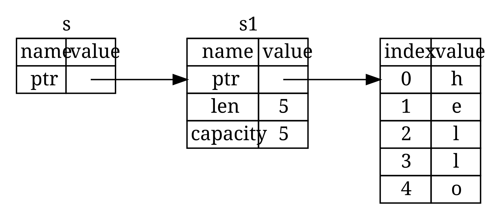

<!-- ia-translate: true -->
## Referências e borrowing {#references-and-borrowing}

O problema do código com tupla da Listagem 4-5 é que precisamos devolver a `String` para a função que chamou, para podermos continuar usando a `String` depois da chamada a `calculate_length`, porque a `String` foi movida para dentro de `calculate_length`. Em vez disso, podemos fornecer uma referência ao valor `String`. Uma referência é como um ponteiro, no sentido de que é um endereço que podemos seguir para acessar os dados armazenados naquele endereço; esses dados pertencem a alguma outra variável. Diferentemente de um ponteiro, uma referência tem a garantia de apontar para um valor válido de um tipo específico durante toda a vida dessa referência.

Aqui está como você definiria e usaria uma função `calculate_length` que tem uma referência a um objeto como parâmetro, em vez de tomar a posse do valor:

<Listing file-name="src/main.rs">

```rust
{{#rustdoc_include ../listings/ch04-understanding-ownership/no-listing-07-reference/src/main.rs:all}}
```

</Listing>

Primeiro, repare que todo o código com tupla, tanto na declaração da variável quanto no valor de retorno da função, sumiu. Segundo, note que passamos `&s1` para `calculate_length` e, na definição dela, recebemos `&String` em vez de `String`. Esses `&` representam referências, e elas permitem que você se refira a algum valor sem tomar a sua posse. A Figura 4-6 ilustra esse conceito.



<span class="caption">Figura 4-6: Um diagrama do `&String` `s` apontando para a
`String` `s1`</span>

> Nota: O oposto de referenciar usando `&` é _desreferenciar_, o que é feito com o operador de desreferência, `*`. Vamos ver alguns usos do operador de desreferência no Capítulo 8 e discutir os detalhes da desreferência no Capítulo 15.

Vamos examinar mais de perto a chamada de função aqui:

```rust
{{#rustdoc_include ../listings/ch04-understanding-ownership/no-listing-07-reference/src/main.rs:here}}
```

A sintaxe `&s1` nos permite criar uma referência que _se refere_ ao valor de `s1`, mas não é dona dele. Como a referência não é dona do valor, o valor para o qual ela aponta não será descartado quando a referência deixar de ser usada.

Da mesma forma, a assinatura da função usa `&` para indicar que o tipo do parâmetro `s` é uma referência. Vamos acrescentar algumas anotações explicativas:

```rust
{{#rustdoc_include ../listings/ch04-understanding-ownership/no-listing-08-reference-with-annotations/src/main.rs:here}}
```

O escopo em que a variável `s` é válida é o mesmo de qualquer parâmetro de função, mas o valor apontado pela referência não é descartado quando `s` deixa de ser usada, porque `s` não tem a posse. Quando funções recebem referências como parâmetros em vez dos valores em si, não precisamos devolver os valores para devolver a posse, porque nunca tivemos a posse.

Chamamos a ação de criar uma referência de _borrowing_ (empréstimo). Assim como na vida real: se uma pessoa é dona de algo, você pode pegar esse algo emprestado dela. Quando terminar, precisa devolver. Você não é o dono.

E então, o que acontece se tentarmos modificar algo que estamos tomando emprestado? Experimente o código da Listagem 4-6. Alerta de spoiler: não funciona!

<Listing number="4-6" file-name="src/main.rs" caption="Tentando modificar um valor emprestado">

```rust,ignore,does_not_compile
{{#rustdoc_include ../listings/ch04-understanding-ownership/listing-04-06/src/main.rs}}
```

</Listing>

Aqui está o erro:

```console
{{#include ../listings/ch04-understanding-ownership/listing-04-06/output.txt}}
```

Assim como variáveis são imutáveis por padrão, as referências também são. Não podemos modificar algo para o qual temos uma referência.

### Referências mutáveis {#mutable-references}

Podemos corrigir o código da Listagem 4-6 para permitir modificar um valor emprestado com apenas alguns pequenos ajustes, usando, em vez disso, uma _referência mutável_:

<Listing file-name="src/main.rs">

```rust
{{#rustdoc_include ../listings/ch04-understanding-ownership/no-listing-09-fixes-listing-04-06/src/main.rs}}
```

</Listing>

Primeiro, mudamos `s` para ser `mut`. Depois, criamos uma referência mutável com `&mut s` no ponto em que chamamos a função `change`, e atualizamos a assinatura da função para aceitar uma referência mutável com `some_string: &mut String`. Isso deixa bem claro que a função `change` vai mutar o valor que ela toma emprestado.

Referências mutáveis têm uma grande restrição: se você tem uma referência mutável para um valor, não pode ter nenhuma outra referência para esse mesmo valor. Este código, que tenta criar duas referências mutáveis para `s`, vai falhar:

<Listing file-name="src/main.rs">

```rust,ignore,does_not_compile
{{#rustdoc_include ../listings/ch04-understanding-ownership/no-listing-10-multiple-mut-not-allowed/src/main.rs:here}}
```

</Listing>

Aqui está o erro:

```console
{{#include ../listings/ch04-understanding-ownership/no-listing-10-multiple-mut-not-allowed/output.txt}}
```

Esse erro diz que este código é inválido porque não podemos tomar `s` emprestado como mutável mais de uma vez ao mesmo tempo. O primeiro empréstimo mutável está em `r1` e precisa durar até ser usado no `println!`, mas, entre a criação dessa referência mutável e o seu uso, tentamos criar outra referência mutável em `r2`, que toma emprestados os mesmos dados de `r1`.

A restrição que impede múltiplas referências mutáveis para os mesmos dados ao mesmo tempo permite a mutação, mas de uma maneira bem controlada. É algo com que os novos Rustaceans costumam ter dificuldade, porque a maioria das linguagens deixa você mutar sempre que quiser. A vantagem dessa restrição é que o Rust consegue impedir _data races_ (condições de corrida de dados) em tempo de compilação. Uma _data race_ é parecida com uma condição de corrida (_race condition_) e acontece quando estes três comportamentos ocorrem:

- Dois ou mais ponteiros acessam os mesmos dados ao mesmo tempo.
- Pelo menos um dos ponteiros está sendo usado para escrever nos dados.
- Não há nenhum mecanismo sendo usado para sincronizar o acesso aos dados.

Data races causam comportamento indefinido e podem ser difíceis de diagnosticar e corrigir quando você tenta rastreá-las em tempo de execução; o Rust evita esse problema recusando-se a compilar código com data races!

Como sempre, podemos usar chaves para criar um novo escopo, o que permite múltiplas referências mutáveis, desde que elas não sejam _simultâneas_:

```rust
{{#rustdoc_include ../listings/ch04-understanding-ownership/no-listing-11-muts-in-separate-scopes/src/main.rs:here}}
```

O Rust impõe uma regra semelhante para combinar referências mutáveis e imutáveis. Este código resulta em erro:

```rust,ignore,does_not_compile
{{#rustdoc_include ../listings/ch04-understanding-ownership/no-listing-12-immutable-and-mutable-not-allowed/src/main.rs:here}}
```

Aqui está o erro:

```console
{{#include ../listings/ch04-understanding-ownership/no-listing-12-immutable-and-mutable-not-allowed/output.txt}}
```

Uf! Também _não_ podemos ter uma referência mutável enquanto temos uma imutável para o mesmo valor.

Quem usa uma referência imutável não espera que o valor mude de repente debaixo dos seus pés! Porém, múltiplas referências imutáveis são permitidas, porque ninguém que apenas lê os dados tem a capacidade de afetar a leitura dos dados feita por outra pessoa.

Repare que o escopo de uma referência começa onde ela é introduzida e continua até a última vez em que essa referência é usada. Por exemplo, este código compila porque o último uso das referências imutáveis está no `println!`, antes de a referência mutável ser introduzida:

```rust
{{#rustdoc_include ../listings/ch04-understanding-ownership/no-listing-13-reference-scope-ends/src/main.rs:here}}
```

Os escopos das referências imutáveis `r1` e `r2` terminam depois do `println!` onde elas são usadas pela última vez, que fica antes de a referência mutável `r3` ser criada. Esses escopos não se sobrepõem, então este código é permitido: o compilador consegue perceber que a referência não está mais sendo usada em um ponto anterior ao fim do escopo.

Mesmo que os erros de empréstimo às vezes sejam frustrantes, lembre-se de que é o compilador do Rust apontando um possível bug cedo (em tempo de compilação, e não em tempo de execução) e mostrando exatamente onde está o problema. Assim, você não precisa rastrear por que os seus dados não são o que você achava que fossem.

### Referências pendentes {#dangling-references}

Em linguagens com ponteiros, é fácil criar por engano um _ponteiro pendurado_ (_dangling pointer_): um ponteiro que referencia uma posição de memória que pode ter sido entregue a outra pessoa, ao liberar um pedaço de memória enquanto se mantém um ponteiro para ele. No Rust, por outro lado, o compilador garante que as referências nunca serão pendentes: se você tem uma referência a algum dado, o compilador garante que o dado não sairá de escopo antes da referência.

Vamos tentar criar uma referência pendente para ver como o Rust as impede com um erro em tempo de compilação:

<Listing file-name="src/main.rs">

```rust,ignore,does_not_compile
{{#rustdoc_include ../listings/ch04-understanding-ownership/no-listing-14-dangling-reference/src/main.rs}}
```

</Listing>

Aqui está o erro:

```console
{{#include ../listings/ch04-understanding-ownership/no-listing-14-dangling-reference/output.txt}}
```

Essa mensagem de erro se refere a um recurso que ainda não abordamos: os lifetimes. Vamos discutir lifetimes em detalhes no Capítulo 10. Mas, se você desconsiderar as partes sobre lifetimes, a mensagem contém a chave para entender por que este código é um problema:

```text
this function's return type contains a borrowed value, but there is no value
for it to be borrowed from
```

Vamos olhar mais de perto o que acontece em cada etapa do nosso código `dangle`:

<Listing file-name="src/main.rs">

```rust,ignore,does_not_compile
{{#rustdoc_include ../listings/ch04-understanding-ownership/no-listing-15-dangling-reference-annotated/src/main.rs:here}}
```

</Listing>

Como `s` é criada dentro de `dangle`, quando o código de `dangle` termina, `s` será desalocada. Mas tentamos retornar uma referência a ela. Isso significaria que a referência apontaria para uma `String` inválida. Isso não pode acontecer! O Rust não nos deixa fazer isso.

A solução aqui é retornar a `String` diretamente:

```rust
{{#rustdoc_include ../listings/ch04-understanding-ownership/no-listing-16-no-dangle/src/main.rs:here}}
```

Isso funciona sem nenhum problema. A posse é transferida para fora, e nada é desalocado.

### As regras das referências {#the-rules-of-references}

Vamos recapitular o que discutimos sobre referências:

- Em qualquer momento, você pode ter _ou_ uma referência mutável _ou_ qualquer número de referências imutáveis.
- As referências devem ser sempre válidas.

A seguir, veremos outro tipo de referência: as slices.
