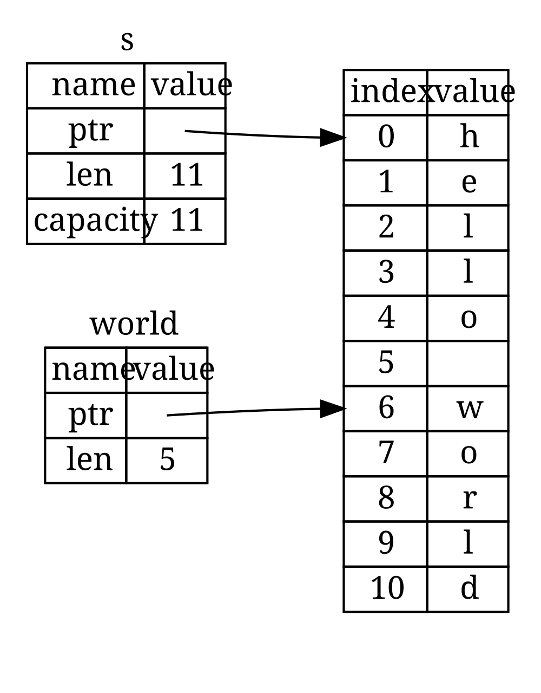

<!-- ia-translate: true -->

## O tipo slice {#the-slice-type}

_Slices_ permitem que você referencie uma sequência contígua de elementos em uma
[coleção](ch08-00-common-collections.md)<!-- ignore -->. Um slice é um tipo de
referência, então ele não tem ownership.

Aqui está um pequeno problema de programação: escreva uma função que recebe uma
string de palavras separadas por espaços e retorna a primeira palavra que
encontrar nessa string. Se a função não encontrar um espaço na string, a string
inteira precisa ser uma única palavra, então a string inteira deve ser retornada.

> Nota: Para fins de introdução aos slices, estamos assumindo apenas ASCII nesta
> seção; uma discussão mais completa sobre o tratamento de UTF-8 está na seção
> [“Armazenando texto codificado em UTF-8 com strings”][strings]<!-- ignore -->
> do Capítulo 8.

Vamos ver como escreveríamos a assinatura desta função sem usar slices, para
entender o problema que os slices vão resolver:

```rust,ignore
fn first_word(s: &String) -> ?
```

A função `first_word` tem um parâmetro do tipo `&String`. Não precisamos de
ownership, então isso está tudo bem. (Em Rust idiomático, funções não tomam o ownership
dos seus argumentos a menos que precisem, e os motivos disso vão ficar claros
conforme avançarmos.) Mas o que devemos retornar? Não temos realmente um jeito de
falar sobre *parte* de uma string. Porém, poderíamos retornar o índice do fim da
palavra, indicado por um espaço. Vamos tentar isso, como mostrado na Listagem 4-7.

<Listing number="4-7" file-name="src/main.rs" caption="A função `first_word` que retorna um valor de índice de byte no parâmetro `String`">

```rust
{{#rustdoc_include ../listings/ch04-understanding-ownership/listing-04-07/src/main.rs:here}}
```

</Listing>

Como precisamos percorrer a `String` elemento por elemento e verificar se um valor
é um espaço, vamos converter nossa `String` em um array de bytes usando o método
`as_bytes`.

```rust,ignore
{{#rustdoc_include ../listings/ch04-understanding-ownership/listing-04-07/src/main.rs:as_bytes}}
```

Em seguida, criamos um iterador sobre o array de bytes usando o método `iter`:

```rust,ignore
{{#rustdoc_include ../listings/ch04-understanding-ownership/listing-04-07/src/main.rs:iter}}
```

Vamos discutir iteradores com mais detalhes no [Capítulo 13][ch13]<!-- ignore -->.
Por enquanto, saiba que `iter` é um método que retorna cada elemento de uma
coleção, e que `enumerate` envolve o resultado de `iter` e retorna cada elemento
como parte de uma tupla, em vez de apenas o elemento. O primeiro elemento da tupla retornada por `enumerate`
é o índice, e o segundo é uma referência ao elemento. Isso é um pouco mais
conveniente do que calcular o índice por conta própria.

Como o método `enumerate` retorna uma tupla, podemos usar padrões para
desestruturar essa tupla. Vamos falar mais sobre padrões no [Capítulo
6][ch6]<!-- ignore -->. No laço `for`, especificamos um padrão que tem `i` para o
índice na tupla e `&item` para o único byte na tupla. Como obtemos uma referência
ao elemento a partir de `.iter().enumerate()`, usamos `&` no padrão.

Dentro do laço `for`, procuramos o byte que representa o espaço usando a sintaxe
de literal de byte. Se encontrarmos um espaço, retornamos a posição. Caso
contrário, retornamos o tamanho da string usando `s.len()`.

```rust,ignore
{{#rustdoc_include ../listings/ch04-understanding-ownership/listing-04-07/src/main.rs:inside_for}}
```

Agora temos uma forma de descobrir o índice do fim da primeira palavra na string,
mas há um problema. Estamos retornando um `usize` sozinho, mas ele só é um número
significativo no contexto do `&String`. Em outras palavras, como ele é um valor
separado da `String`, não há garantia de que ele ainda será válido no futuro.
Considere o programa da Listagem 4-8, que usa a função `first_word` da Listagem 4-7.

<Listing number="4-8" file-name="src/main.rs" caption="Armazenando o resultado da chamada da função `first_word` e depois alterando o conteúdo da `String`">

```rust
{{#rustdoc_include ../listings/ch04-understanding-ownership/listing-04-08/src/main.rs:here}}
```

</Listing>

Este programa compila sem erros e também compilaria se usássemos `word` depois de
chamar `s.clear()`. Como `word` não está conectado ao estado de `s` de forma
alguma, `word` ainda contém o valor `5`. Poderíamos usar esse valor `5` com a
variável `s` para tentar extrair a primeira palavra, mas isso seria um bug, porque
o conteúdo de `s` mudou desde que salvamos `5` em `word`.

Ter que se preocupar com o índice em `word` ficar fora de sincronia com os dados
em `s` é cansativo e propenso a erros! Gerenciar esses índices fica ainda mais
frágil se escrevermos uma função `second_word`. Sua assinatura teria que ser
assim:

```rust,ignore
fn second_word(s: &String) -> (usize, usize) {
```

Agora estamos acompanhando um índice inicial _e_ um final, e temos ainda mais
valores que foram calculados a partir de dados de determinado estado, mas que não
estão atrelados a esse estado de forma alguma. Temos três variáveis não
relacionadas soltas que precisam ser mantidas em sincronia.

Felizmente, Rust tem uma solução para esse problema: string slices.

### String slices {#string-slices}

Um _string slice_ é uma referência a uma sequência contígua de elementos de uma
`String`, e se parece com isto:

```rust
{{#rustdoc_include ../listings/ch04-understanding-ownership/no-listing-17-slice/src/main.rs:here}}
```

Em vez de uma referência à `String` inteira, `hello` é uma referência a uma parte
da `String`, especificada pelo trecho extra `[0..5]`. Criamos slices usando um
intervalo entre colchetes, especificando
`[starting_index..ending_index]`, onde _`starting_index`_ é a primeira posição no
slice e _`ending_index`_ é uma posição a mais que a última posição no slice.
Internamente, a estrutura de dados do slice armazena a posição inicial e o
comprimento do slice, que corresponde a _`ending_index`_ menos _`starting_index`_.
Assim, no caso de `let world = &s[6..11];`, `world` seria um slice que contém um
ponteiro para o byte no índice 6 de `s`, com um valor de comprimento de `5`.

A Figura 4-7 mostra isso em um diagrama.



<span class="caption">Figura 4-7: Um string slice referindo-se a parte de uma
`String`</span>

Com a sintaxe de intervalo `..` do Rust, se você quiser começar no índice 0, pode
omitir o valor antes dos dois pontos. Em outras palavras, estes são iguais:

```rust
let s = String::from("hello");

let slice = &s[0..2];
let slice = &s[..2];
```

Do mesmo modo, se o seu slice incluir o último byte da `String`, você pode omitir o
número final. Isso significa que estes são iguais:

```rust
let s = String::from("hello");

let len = s.len();

let slice = &s[3..len];
let slice = &s[3..];
```

Você também pode omitir os dois valores para pegar um slice da string inteira.
Então, estes são iguais:

```rust
let s = String::from("hello");

let len = s.len();

let slice = &s[0..len];
let slice = &s[..];
```

> Nota: Os índices de intervalo de um string slice precisam estar em limites
> válidos de caracteres UTF-8. Se você tentar criar um string slice no meio de um
> caractere multibyte, seu programa vai terminar com um erro.

Com todas essas informações em mente, vamos reescrever `first_word` para retornar
um slice. O tipo que representa “string slice” é escrito como `&str`:

<Listing file-name="src/main.rs">

```rust
{{#rustdoc_include ../listings/ch04-understanding-ownership/no-listing-18-first-word-slice/src/main.rs:here}}
```

</Listing>

Obtemos o índice do fim da palavra da mesma forma que fizemos na Listagem 4-7,
procurando a primeira ocorrência de um espaço. Quando encontramos um espaço,
retornamos um string slice usando o início da string e o índice do espaço como
índices inicial e final.

Agora, quando chamamos `first_word`, recebemos de volta um único valor que está
atrelado aos dados subjacentes. O valor é composto por uma referência ao ponto
inicial do slice e pelo número de elementos no slice.

Retornar um slice também funcionaria para uma função `second_word`:

```rust,ignore
fn second_word(s: &String) -> &str {
```

Agora temos uma API direta que é muito mais difícil de usar errado, porque o
compilador vai garantir que as referências para a `String` continuem válidas.
Lembra do bug no programa da Listagem 4-8, quando pegamos o índice do fim da
primeira palavra, mas depois limpamos a string, e nosso índice ficou inválido?
Aquele código estava logicamente incorreto, mas não mostrava nenhum erro imediato.
Os problemas apareceriam mais tarde, se continuássemos tentando usar o índice da
primeira palavra com uma string vazia. Slices tornam esse bug impossível e nos
avisam muito mais cedo que temos um problema no código. Usar a versão com slice
de `first_word` vai gerar um erro de compilação:

<Listing file-name="src/main.rs">

```rust,ignore,does_not_compile
{{#rustdoc_include ../listings/ch04-understanding-ownership/no-listing-19-slice-error/src/main.rs:here}}
```

</Listing>

Aqui está o erro do compilador:

```console
{{#include ../listings/ch04-understanding-ownership/no-listing-19-slice-error/output.txt}}
```

Lembre-se das regras de borrowing: se temos uma referência imutável a algo, não
podemos também pegar uma referência mutável. Como `clear` precisa truncar a
`String`, ele precisa obter uma referência mutável. O `println!` depois da chamada
a `clear` usa a referência em `word`, então a referência imutável ainda precisa
estar ativa naquele ponto. O Rust proíbe que a referência mutável em `clear` e a
referência imutável em `word` existam ao mesmo tempo, e a compilação falha. O Rust
não só tornou nossa API mais fácil de usar, como também eliminou toda uma classe
de erros em tempo de compilação!

<!-- Old headings. Do not remove or links may break. -->

<a id="string-literals-are-slices"></a>

#### Literais de string como slices {#string-literals-as-slices}

Lembre que falamos que literais de string são armazenados dentro do binário. Agora
que conhecemos slices, podemos entender corretamente os literais de string:

```rust
let s = "Hello, world!";
```

O tipo de `s` aqui é `&str`: é um slice apontando para aquele ponto específico do
binário. É também por isso que literais de string são imutáveis; `&str` é uma
referência imutável.

#### String slices como parâmetros {#string-slices-as-parameters}

Saber que você pode pegar slices de literais e de valores `String` nos leva a mais
uma melhoria em `first_word`, e essa é a sua assinatura:

```rust,ignore
fn first_word(s: &String) -> &str {
```

Um Rustacean mais experiente escreveria a assinatura mostrada na Listagem 4-9,
porque ela permite usar a mesma função tanto com valores `&String` quanto com
valores `&str`.

<Listing number="4-9" caption="Melhorando a função `first_word` usando um string slice para o tipo do parâmetro `s`">

```rust,ignore
{{#rustdoc_include ../listings/ch04-understanding-ownership/listing-04-09/src/main.rs:here}}
```

</Listing>

Se temos um string slice, podemos passá-lo diretamente. Se temos uma `String`,
podemos passar um slice da `String` ou uma referência à `String`. Essa
flexibilidade aproveita as _deref coercions_, um recurso que vamos abordar na
seção [“Usando deref coercions em funções e métodos”][deref-coercions]<!--
ignore --> do Capítulo 15.

Definir uma função que recebe um string slice em vez de uma referência a uma
`String` torna nossa API mais geral e útil, sem perder nenhuma funcionalidade:

<Listing file-name="src/main.rs">

```rust
{{#rustdoc_include ../listings/ch04-understanding-ownership/listing-04-09/src/main.rs:usage}}
```

</Listing>

### Outros slices {#other-slices}

String slices, como você pode imaginar, são específicos para strings. Mas existe
também um tipo de slice mais geral. Considere este array:

```rust
let a = [1, 2, 3, 4, 5];
```

Assim como podemos querer nos referir a parte de uma string, podemos querer nos
referir a parte de um array. Faríamos isso assim:

```rust
let a = [1, 2, 3, 4, 5];

let slice = &a[1..3];

assert_eq!(slice, &[2, 3]);
```

Este slice tem o tipo `&[i32]`. Ele funciona do mesmo jeito que os string slices,
armazenando uma referência ao primeiro elemento e um comprimento. Você vai usar
esse tipo de slice para todos os outros tipos de coleções. Vamos discutir essas
coleções em detalhes quando falarmos de vetores no Capítulo 8.

## Resumo {#summary}

Os conceitos de ownership, borrowing e slices garantem a segurança de memória em
programas Rust em tempo de compilação. A linguagem Rust te dá controle sobre o uso
de memória da mesma forma que outras linguagens de programação de sistemas. Mas
ter o dono dos dados limpando-os automaticamente quando ele sai de escopo significa
que você não precisa escrever e depurar código extra para ter esse controle.

O ownership afeta como muitas outras partes do Rust funcionam, então vamos falar
desses conceitos mais adiante ao longo do restante do livro. Vamos seguir para o
Capítulo 5 e ver como agrupar pedaços de dados em um `struct`.

[ch13]: ch13-02-iterators.html
[ch6]: ch06-02-match.html#patterns-that-bind-to-values
[strings]: ch08-02-strings.html#storing-utf-8-encoded-text-with-strings
[deref-coercions]: ch15-02-deref.html#using-deref-coercions-in-functions-and-methods
